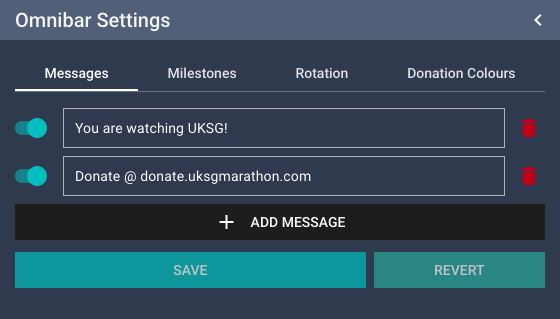
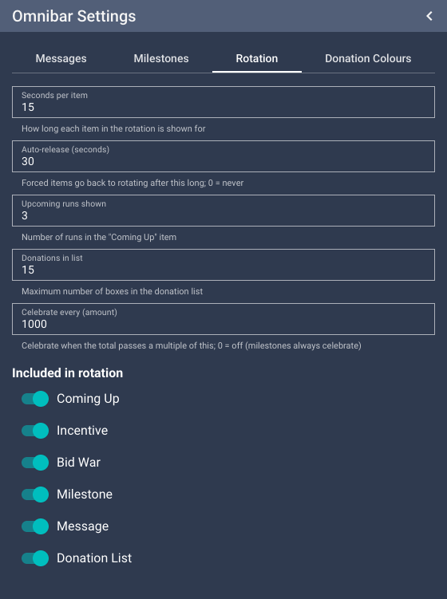

# Omnibar

The omnibar is the bar along the bottom of every scene. From left to right:

- **Event logo and charity logo**
- **Donation total**: counts up smoothly as donations come in.
- **The rotating section**: see below.
- **Clock**: UK time and date.

## What rotates

The middle of the omnibar shows one item at a time, about 15 seconds each, and slides between them. Items are shown in this order,
skipping any that have nothing to show:

1. **Coming up**: the next three runs, with the runners, category and roughly how long until each starts.
   Game names are never cut off; if they don't all fit, the row slowly scrolls across to show the rest.
   
2. **Incentive**: a donation goal, with a progress bar and how much is left to go. If the name is long, the bar moves
   underneath it so the name is never cut off.
   
   
3. **Message**: one of your custom messages (e.g. the donation link).
   
4. **Bid war**: a two-option bid war is shown as a tug-of-war bar; three or more options are shown as bars sized by
   each option's share of the total.
   
   
5. **Donation list**: the most recent donations as coloured boxes (colour depends on the amount), running off the edge
   of the screen to show there have been more.
   
6. **Milestone**: progress towards the next donation milestone.
   
7. **Message**: the next custom message.

Each type takes turns through its own items, so with several incentives you'll see a different one each time.

Some things are **never shown automatically**, only when a host chooses to show them (see the [Host guide](hosts.md)):

- Donation shout-outs (an individual donation with its comment)
- A single upcoming run
- Incentives that have already met their goal

### About the "coming up" times

The times are estimates: the time left on the current run's estimate, plus the estimates and setup times of the runs in between.
**They only count down while the timer is running.** Before a run has started (or while it's paused), the full
estimate is assumed to still be left, so the times stay where they are.

### Celebrations

When the donation total passes a milestone, or a round number (every £1,000 by default), the donation total briefly
flips to a celebration ("£2,000 raised!", or the milestone's name).

## Omnibar Settings panel

In the **UKSG** tab. Changes apply straight away unless the tab has a **Save** button.

### Messages tab

The custom messages that rotate on the omnibar, e.g. "You are watching UKSG!" and the donation link.

- Type the message in the box. Long messages scroll across instead of being cut off.
- The switch on the left includes or excludes the message from the rotation. Switched-off messages can still be shown
  by a host from Host Control.
- **Add message** adds a new one, the bin icon removes one.
- Press **Save** when you're done (or **Revert** to throw your changes away).

### Milestones tab

Donation milestones, e.g. "£2,500: the host sings the Proclaimers".

- **Amount**: the donation total the milestone is reached at.
- **Name**: what's shown in large text.
- **Description** (optional): shown in smaller text above the name.
- Press **Save** when you're done.

The omnibar rotation shows progress towards the next milestone that hasn't been reached yet. Hosts can show any milestone
from Host Control. When the total passes a milestone, the donation total celebrates with the milestone's name.

### Rotation tab

| Setting | Default | What it does |
| --- | --- | --- |
| Seconds per item | 15 | How long each rotating item stays on screen. |
| Auto-release (seconds) | 30 | How long something a host shows stays pinned before the rotation carries on. 0 = stay until released. |
| Upcoming runs shown | 3 | How many runs the "Coming up" item shows. |
| Donations in list | 15 | How many recent donations the donation list includes. |
| Celebrate every (amount) | 1000 | Celebrate when the total passes a multiple of this. 0 = only celebrate milestones. |
| Included in rotation | all on | Switch whole item types (e.g. bid wars) out of the rotation. |

### Donation Colours tab

The colour of each donation's box in the donation list (and on shout-outs) depends on its amount. Each row is "from this
amount, use this colour"; a donation uses the highest tier it reaches. Defaults:

| From | Colour |
| --- | --- |
| £5 | Dark blue |
| £20 | Light blue |
| £50 | Gold |
| £100 | Pink/red |

Press **Save** when you're done.
