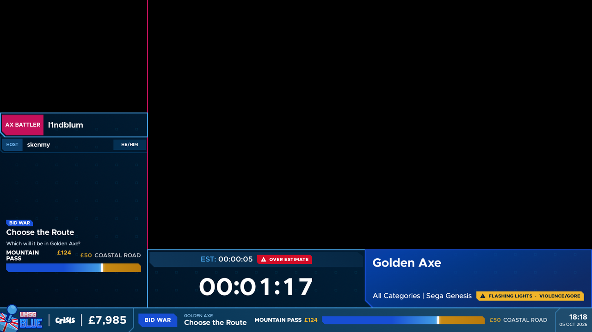
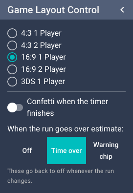
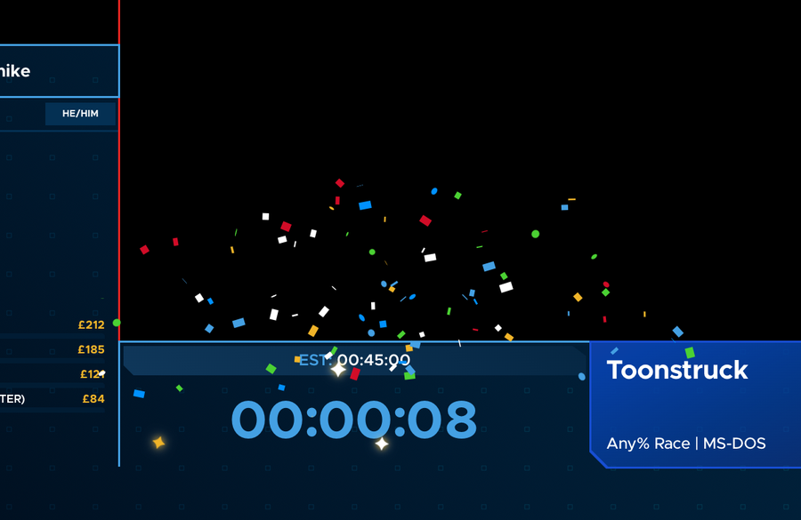
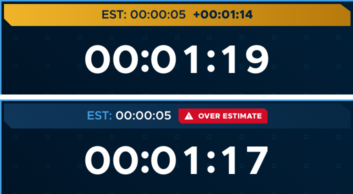
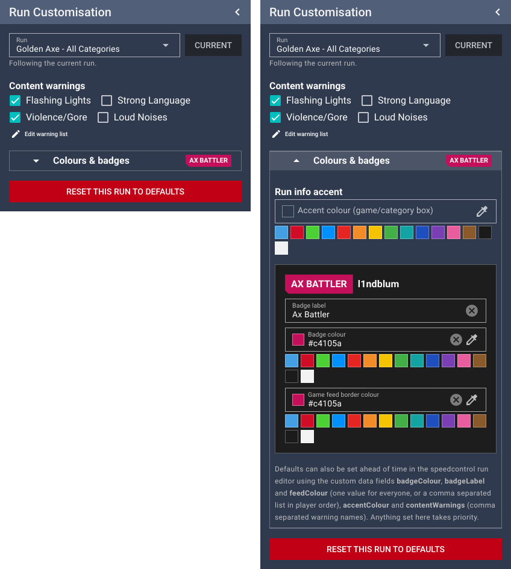
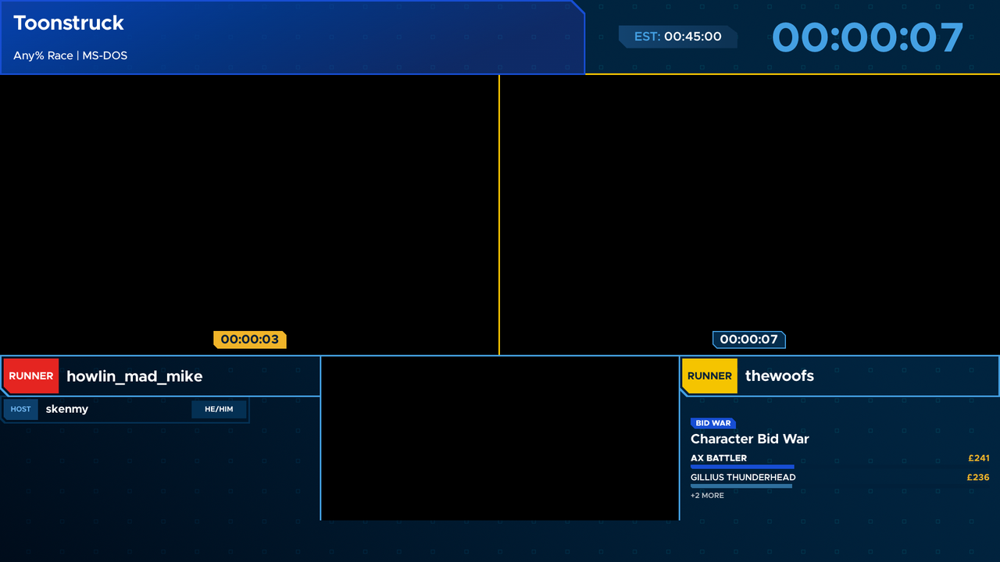

# Runs & game layouts

The game layout is the main screen while a run is on.

It shows:

- **Game feed(s) and camera**: windows for OBS to show the game captures and runner camera.
  If tech has connected OBS, the captures are moved and resized automatically to fit whichever layout is chosen.
- **Name boxes**: the runner(s) (from the speedcontrol schedule), and the host and commentators (from
  [Participant Control](intermission-and-more.md#participant-control)). Empty name boxes are hidden.
- **The game badge**: the game name, category and platform, plus any [content warnings](#content-warnings) for the run.
- **The timer**: the run timer with the estimate above it.
- **The image box**: rotating images (sponsors, charity info and so on), taking turns with cards for the current run's
  incentives (see [Incentives in the image box](#incentives-in-the-image-box)).

## Layouts

| Layout | For |
| --- | --- |
| 4:3 1 Player | Older/4:3 games, one runner |
| 4:3 2 Player | 4:3 games, races/co-op with two feeds |
| 16:9 1 Player | Widescreen games, one runner |
| 16:9 2 Player | Widescreen games, races/co-op with two feeds |
| 3DS 1 Player | Dual-screen handhelds (two game feeds: top and bottom screen) |

## Game Layout Control

In the main workspace.

- **Layout list**: pick the layout for the current run. When the run changes in speedcontrol, the layout switches
  automatically if the schedule says which layout the run uses; otherwise pick it here.
- **Confetti when the timer finishes**: when switched on, the timer celebrates with confetti and sparkles the moment
  the run finishes. For races, that's when the last runner finishes.

  

- **When the run goes over estimate**: what to show once the timer passes the run's estimate:
  - **Off**: nothing.
  - **Time over**: the estimate box turns amber and counts how far over it is, e.g. `EST: 00:45:00 +00:03:21`.
  - **Warning chip**: a red "⚠ Over estimate" chip appears next to the estimate.

  

> **Confetti and the over-estimate warning are off by default and switch back off whenever the run changes.**
> Turn them on for each run that should have them.

## Run Customisation

In the main workspace.

By default it shows the **current run** ("Following the current run"); pick another run from
the list to set things up in advance, and press **Current** to go back.

### Content warnings

Tick any warnings that apply to the run, e.g. **Flashing Lights** or **Strong Language**. They appear as an amber chip
in the game badge next to the category for the whole run, e.g. `Any% | PC ⚠ FLASHING LIGHTS · STRONG LANGUAGE`.

Warnings belong to that run, so ticking them for one run doesn't affect any other.

To change which warnings are available, press **Edit warning list**: rename, remove or **Add** warnings, then press
**Save list**. The defaults are Flashing Lights, Strong Language, Violence/Gore and Loud Noises.

### Colours & badges

Closed by default to keep the panel tidy. Click the **Colours & badges** row to open it. The row shows a small
preview of the current runner badges so you can see at a glance if anything's been changed.

| Setting | What it changes |
| --- | --- |
| **Accent colour** | The colour of the game badge (the box with the game name), instead of the event colour. |
| **Badge label** (per runner) | The text in the runner's badge, normally "RUNNER", e.g. a character name, or "Racer". |
| **Badge colour** (per runner) | The colour of the runner's badge, e.g. to match the character they play. Text switches between dark and white automatically so it's readable. |
| **Game feed border colour** (per runner) | The colour of the border around that runner's game feed. Handy in races so each side matches its runner. |

Each colour box has quick swatches (the UKSG colours plus common character colours), a colour picker (the pipette icon)
and takes a hex colour code like `#e52521` (colour names such as "yellow" aren't used; the box shows an error).
Clear a box (the ⓧ) to go back to the default.

**Reset this run to defaults** clears everything set here for the run, including warnings.

> Tech can also set badge colours/labels, accent colours and warnings ahead of time in the schedule data. Anything set
> on this panel takes priority over that. If the schedule is re-imported into speedcontrol, settings made on this panel
> for that run are lost (the runs get new IDs), so make changes after the final import where possible.

## Races

In the 2 player layouts, when a runner finishes (their timer is stopped in speedcontrol), a badge pops up at the bottom
of **their game feed** showing their time. The fastest finish is gold; anyone who forfeits shows **Forfeit**.
Undoing a runner's finish in speedcontrol removes the badge.

## Incentives in the image box

While a run is on, the image box takes turns showing rotating images (about 40 seconds) and cards for the current run's
incentives (about 20 seconds each): goal progress bars, tug-of-war bars for two-option bid wars, or bars for bigger bid
wars. If no images have been uploaded, it just cycles through the incentives. Incentives that have already met their
goal aren't included.

See [Incentives & donations](incentives-and-donations.md) for where this information comes from.
